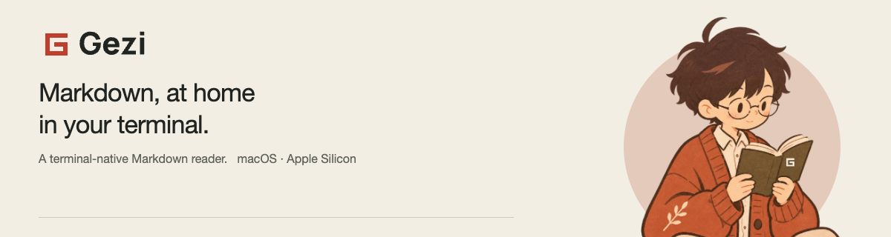

<picture>
  <source media="(prefers-color-scheme: dark)" srcset="assets/brand/readme-dark.png">
  
</picture>

**Markdown, at home in your terminal.**

Gezi (格子) is a lightweight Markdown reader for macOS Apple Silicon, designed
for Kaku. Read files, search text, navigate headings and render Markdown streams
with `gezi` or its equivalent short command, `ge`.

Current releases are read-only. Editing, undo/redo and saving are planned.

<a id="installation-details"></a>

## Install

```sh
curl -fsSL https://raw.githubusercontent.com/HiAriesZhou/Gezi/main/install.sh | sh
```

Installs both commands to `~/.local/bin` after verifying SHA256. No Rust or sudo
is needed. [Installation details](docs/installation.md) cover PATH setup, custom
destinations and source builds. You can also [install with a coding agent](docs/installation.md#install-with-a-coding-agent).

## Quick start

```sh
gezi README.md                       # Open the interactive reader
ge README.md                         # Same reader, shorter command
cat notes.md | gezi                   # Render a Markdown stream
gezi --ansi README.md                 # Print once and return to the shell
gezi --theme neon-tokyo README.md     # Choose a theme
gezi help                            # Command-line options
```

In the reader, press `/` to search, `o` for the outline, `?` for help and `q` to
exit. Drag text to copy on release, or click **Copy** on a code block to copy its
original text. Press `m` to switch a visible Mermaid block between preview and source.
See the [reader guide](docs/reader.md) for controls and settings.

The English/Chinese interface follows Kaku's app language preference, then the
system, with English as the fallback. Press `L` or F2 to switch for the session,
or use `--language en|zh|auto`. See [language selection](docs/reader.md#interface-language)
for the full precedence and exceptions.

## Features and limits

- Highlighted code, tables, links, lists and mixed Chinese/English layout.
- Main-screen reading with search and a heading outline, preserving terminal history.
- Local and remote PNG, JPEG and static SVG images in the inline reader in direct Kaku.
- Native Mermaid previews for six basic diagram types, with source switching and searching.
- Markdown streams and Claude Code JSONL: `cat events.jsonl | gezi --from claude-json`.
- Automatic light/dark themes, custom TOML palettes and optional large H1 headings.

Remote images load by default and contact the hosts in the document. Use
`--remote-images off` for local images only, or `--images off` to disable loading.
Streams, native output and unsupported terminals use text labels. Clipboard
writes require local macOS, not SSH. Details: [images](docs/reader.md#images),
[copying](docs/reader.md#copying) and [output modes](docs/reader.md#output-and-configuration).

Mermaid previews require the same graphics support; other output retains code.
See [supported diagrams and limitations](docs/reader.md#mermaid).

## Update

```sh
gezi update                          # Or: ge update
```

The updater verifies the download, backs up the old binary and updates both
commands beside the running executable. Current or newer installations are left
unchanged. Cargo installations use [Cargo to update](docs/installation.md#source-installation).

## Planned

- Edit Markdown source, with cursor movement, selection, Chinese input and undo/redo.
- Save safely, with unsaved-change prompts and external-file change detection.
- Switch between source and rendered views while preserving position.
- Find and replace, then task-list and code-block editing shortcuts.

## Documentation

| Guide | Contents |
| --- | --- |
| [Installation](docs/installation.md) | Install, update, source builds and agent instructions |
| [Reader](docs/reader.md) | Controls, search, copying, language, images and native Kaku mode |
| [Themes](themes/README.md) | Built-in palettes and custom TOML schema |
| [Architecture](docs/architecture.md) | Module boundaries and implementation contracts |
| [Testing](docs/terminal-testing.md) | Automated checks and real-terminal acceptance |
| [Releases](docs/release.md) | Packaging, publication and recovery |
| [Website](docs/website.md) / [Brand](assets/brand/README.md) | Site maintenance and artwork |

See the [changelog](CHANGELOG.md) for release history and [repository rules](AGENTS.md)
for contributions. Bug reports should include the Gezi version, terminal and a
minimal Markdown example.

[MIT License](LICENSE)
