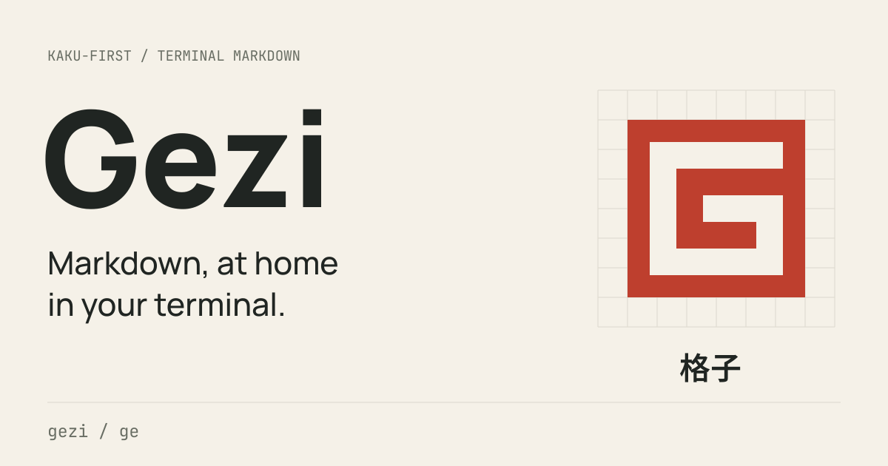

<picture>
  <source media="(prefers-color-scheme: dark)" srcset="assets/brand/og-image.svg">
  
</picture>

**Markdown, at home in your terminal.**

A Kaku-first Markdown editor for the terminal, built for developer and AI workflows.

Gezi (格子, “grid” in Chinese) takes its name from manuscript paper and the
terminal’s character grid. Use `gezi` or the shorter `ge`; both run the same editor.

**In development:** current releases deliver the reading and rendering foundation.
Editing, undo/redo and saving files are next. macOS Apple Silicon is supported.

## Install

Install the latest release:

```sh
curl -fsSL https://raw.githubusercontent.com/HiAriesZhou/Gezi/main/install.sh | sh
```

Installs `gezi` and `ge` to `~/.local/bin`. See [installation details](#installation-details)
for PATH setup, other options and a copyable coding-agent prompt.

## Quick start

```sh
gezi README.md                       # Open the interactive reader
ge README.md                         # Short form of the same command
cat notes.md | gezi                   # Render a Markdown stream
gezi --ansi README.md                 # Print once and return to the shell
gezi --remote-images off README.md    # Load local images only
gezi --theme neon-tokyo README.md     # Choose a theme
gezi help
```

File reading is interactive when stdin and stdout are terminals. Press `q` to
exit. Use `--reader inline` if you previously configured native output.

| Key | Action |
| --- | --- |
| Scroll wheel, ↑ / ↓, `j` / `k` | Scroll |
| `/`, then Enter; `n` / `N` | Search; next / previous match |
| `o`; Tab | Toggle the outline; switch panes |
| `c` | Choose and copy a code block |
| `?` | Help for the current view |

## Update

Update to the latest stable release:

```sh
gezi update
# Equivalent short command:
ge update
```

The updater verifies SHA256, backs up the previous binary and updates both
commands beside the running executable. It does nothing when the installed
version is already current or newer. It does not require sudo.

The built-in updater supports macOS binary-package installations. For Cargo
source builds, use the [source installation command](docs/architecture.md#source-installation)
with `--force`. To switch installation methods, use a separate directory or
uninstall the Cargo package first.

## Available today

- Markdown rendering with highlighted code, tables, links, lists and mixed Chinese/English layout.
- Interactive reading with search, a heading sidebar, repeated navigation and a responsive footer.
- Code copying that preserves indentation and line breaks, without rendered borders.
- Local and remote PNG, JPEG and static SVG images in direct Kaku sessions, including HTML `` and badge rows.
- Incremental Markdown output and a Claude Code stream-json adapter: `cat events.jsonl | gezi --from claude-json`.
- Automatic light/dark themes, custom TOML themes and optional large H1 headings in Kaku.
- Main-screen reading that preserves terminal history and restores terminal input on exit.

Remote images load by default and contact the hosts in the document. Use
`--remote-images off` to disable remote loading or `--images off` to disable all
image loading. Graphics require the inline reader in direct Kaku; native output,
streams and other terminals keep text labels. Code copying requires local macOS.

## TODO

Editing is planned; these capabilities are not in the current release. In order:

- [ ] Editable Markdown source with cursor movement, selection, Chinese input and undo/redo.
- [ ] Safe saving, unsaved-change prompts and detection of external file changes.
- [ ] Switch between source and rendered views while keeping the reading/editing position.
- [ ] Find and replace, followed by task-list and code-block editing shortcuts.

## Documentation

- [Reader guide](docs/reader.md): navigation, images and optional Kaku integration.
- [Themes](themes/README.md): built-in palettes and custom themes.
- [Changelog](CHANGELOG.md): changes by release.
- [Brand assets](assets/brand/README.md): logos, slogans, social images and usage guidelines.

For contributors: [architecture](docs/architecture.md),
[testing](docs/terminal-testing.md), [release maintenance](docs/release.md)
and [repository rules](AGENTS.md). Bug reports should include the gezi version,
terminal and a minimal Markdown example.

## Installation details

The installer verifies SHA256, installs to `~/.local/bin`, and keeps a backup when
replacing an existing binary. No Rust, sudo or shell configuration changes are
needed. If the directory is not on your PATH, add this line to `~/.zshrc` and run
it in your current shell:

```sh
export PATH="$HOME/.local/bin:$PATH"
```

To choose a release or directory, set `GEZI_VERSION=v0.1.7` or
`GEZI_INSTALL_DIR=/absolute/path` on the `sh` command. You can also inspect
[install.sh](install.sh) or download the archive and checksum from
[Releases](https://github.com/HiAriesZhou/Gezi/releases/latest).
Packages are ad hoc signed, without Developer ID signing or notarization.

### Install with a coding agent

Copy the entire prompt below into your coding agent. On GitHub, use the copy
button in the upper-right corner of the block:

```text
Install the latest stable Gezi release from
https://github.com/HiAriesZhou/Gezi on this machine.

1. Check that this is Apple Silicon macOS running in a native arm64 shell.
   If it is unsupported, stop and explain.
2. Check existing gezi and ge commands, including aliases, symlinks and their
   installation method. Do not overwrite another tool or mix Cargo and
   binary-package installations. If there is a conflict, explain it before
   making changes.
3. Download https://raw.githubusercontent.com/HiAriesZhou/Gezi/main/install.sh
   to a temporary file, inspect it, and run it with sh. Use the default
   ~/.local/bin destination, keep download checksum verification enabled,
   and do not use sudo. Preserve existing configuration and unrelated files.
4. Ensure ~/.local/bin is on PATH. If a shell startup change is needed,
   explain it and add only the missing entry without replacing existing
   settings.
5. Verify gezi --version, ge --version, gezi help, and rendering a short
   Markdown sample. Confirm that both commands resolve to this installation
   and report the same version.
6. Report the installed paths and version, show how to open a Markdown file
   with gezi or ge, and explain that future updates use gezi update or
   ge update. Stop and report any error rather than claiming installation
   succeeded.
```

[MIT License](LICENSE)
