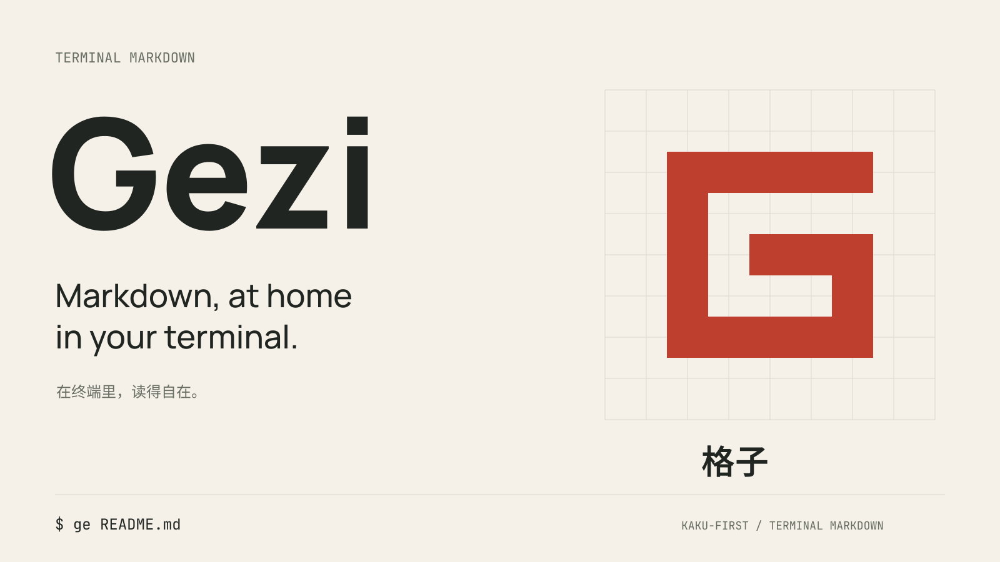

# Gezi brand assets

Gezi (格子) is a Kaku-first terminal Markdown project. Its mark is an open,
square G drawn on the same grid used in the surrounding artwork. Paper, ink
and vermilion connect the terminal's character cells with Chinese manuscript
paper without using calligraphy or another product's logo.

## Name and slogans

- Primary name: **Gezi**. Chinese name: **格子**.
- Primary slogan: **Markdown, at home in your terminal.**
- Chinese companion: **在终端里，读得自在。**
- Short descriptor: **Kaku-first terminal Markdown.**
- Commands: `gezi` and `ge`.

Use the English name and slogan by default. The Chinese companion expresses
comfortable reading; it is not a literal translation. Keep the comma and final
period in the English slogan. Do not use Japanese text or describe the current
release as already providing editing, undo/redo or saving.

## Files

All SVG files are self-contained vectors. Their lettering is outlined, so they
need no installed fonts, network requests or external images. PNG exports use
sRGB. Use PNG for social previews; many crawlers do not accept SVG.

| Asset | Dimensions | Use |
| --- | --- | --- |
| [logo.svg](logo.svg), [logo.png](logo.png) | SVG 304 × 96; PNG 608 × 192 | Transparent primary logo, for light surfaces |
| [logo-on-dark.svg](logo-on-dark.svg), [logo-on-dark.png](logo-on-dark.png) | SVG 304 × 96; PNG 608 × 192 | Paper-white logo, for dark surfaces |
| [logo-mono.svg](logo-mono.svg), [logo-mono.png](logo-mono.png) | SVG 304 × 96; PNG 608 × 192 | Single-color ink logo |
| [mark.svg](mark.svg), [mark-ink.svg](mark-ink.svg), [mark-paper.svg](mark-paper.svg) | 64 × 64 | Standalone G in vermilion, ink or paper |
| [avatar.svg](avatar.svg), [avatar.png](avatar.png) | 512 × 512 | Square vermilion avatar; safe for circular cropping |
| [avatar-ink.svg](avatar-ink.svg), [avatar-ink.png](avatar-ink.png) | 512 × 512 | Square ink avatar |
| [favicon.svg](favicon.svg), [favicon.ico](favicon.ico) | SVG 32 × 32; ICO 16, 32 and 48 | Browser tab icon |
| [favicon-16.png](favicon-16.png), [favicon-32.png](favicon-32.png), [favicon-48.png](favicon-48.png) | 16, 32 and 48 square | Small raster icons |
| [apple-touch-icon.png](apple-touch-icon.png) | 180 × 180 | Apple touch icon with opaque background |
| [brand-image.svg](brand-image.svg), [brand-image.png](brand-image.png) | 1600 × 900 | General brand image, announcements and presentation covers |
| [og-image.svg](og-image.svg), [og-image.png](og-image.png) | 1200 × 630 | Default dark Open Graph sharing preview |
| [og-image-light.svg](og-image-light.svg), [og-image-light.png](og-image-light.png) | 1200 × 630 | Optional light sharing preview |
| [github-social.svg](github-social.svg), [github-social.png](github-social.png) | 1280 × 640 | GitHub repository social preview |

Open Graph is the metadata a website supplies to services that create link
previews. These files do not configure a website or change GitHub settings.
Upload `github-social.png` in the repository's social-preview settings when
ready. A website should serve `og-image.png` at a public, absolute HTTPS URL and
set `og:image`, `og:image:width` (1200), `og:image:height` (630), `og:image:type`
(`image/png`), and `og:image:alt`. Use `summary_large_image` for `twitter:card`.

Suggested alternative text: "Gezi (格子). Markdown, at home in your terminal.
A Kaku-first terminal Markdown project."

## Color and type

| Token | Value | Role |
| --- | --- | --- |
| Paper | `#F5F1E8` | Light background and reversed lettering |
| Ink | `#202522` | Primary text and dark background |
| Vermilion | `#BE3F2E` | Primary mark and avatar background |
| Muted ink | `#686D63` | Supporting text on paper |
| Muted paper | `#C6C9BC` | Supporting text on ink |
| Paper grid | `#DCD8CD` | Background grid on paper |
| Ink grid | `#3B403B` | Background grid on ink |

Use the first three as the core palette. The grid colors are decoration, not
text colors. On dark backgrounds, reverse the mark to paper or put it on a
vermilion tile; do not use small vermilion text directly on ink.

- **Manrope ExtraBold (800)** for the English wordmark; **Manrope Medium (500)**
  for the slogan. Its broad, rounded counters balance the square mark.
- **Noto Sans SC SemiBold (600)** for 格子; **Regular (400)** for the Chinese
  companion. Use Simplified Chinese glyphs.
- **JetBrains Mono Regular (400)** for commands and short technical descriptors.
  This is also a font shipped by Kaku; the Gezi symbol is independently drawn.

The font families use the SIL Open Font License 1.1. Font binaries are not
included; see [font notices](FONT-NOTICES.txt). Outlined SVGs are the editable
vector masters. To change wording, typeset it with the listed fonts and weights,
then convert the replacement text to outlines before export.

## Usage rules

- Preserve proportions. Do not stretch, rotate, add shadows or apply gradients.
- Keep at least one stroke width of clear space around the visible mark. The
  standalone files include this space. Do not trim it away.
- Use the standalone mark or favicon below 152 px of logo width. The favicon
  artwork is intended for 16 px and above; do not shrink a social card into an icon.
- Keep the avatar's whole square when preparing a circular crop. Its visible G
  fits within the circle; extra zoom can clip the corners.
- Keep social images at their supplied aspect ratios. Use the square avatar when
  a destination requires a square image instead of cropping the wide artwork.
- Keep large grids in brand artwork. Do not add grid lines inside small icons.
- These are brand graphics, not screenshots of the application. No release
  numbers, performance claims or unshipped features appear in the artwork.

The root project's license applies to the original brand artwork. Typeface
licensing is recorded separately in the font notices.
