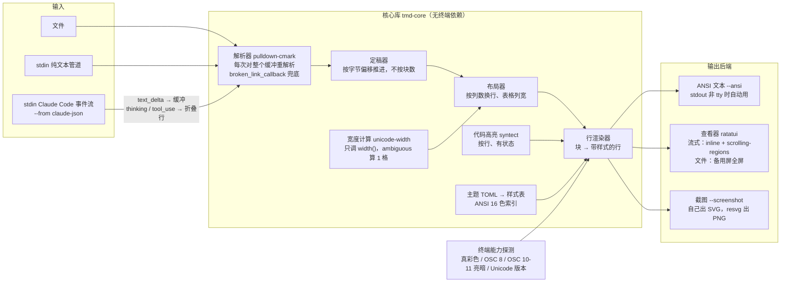
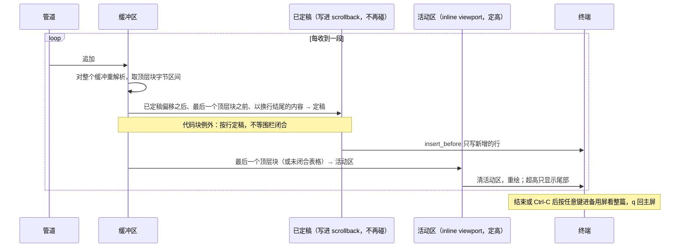

# TMD（Terminal MarkDown）· 技术架构 v3

v3 依据：2026-10-27 复审（Project 文档 claude/TMD-方案复审.md）。v2 依据：2026-10-26 审查。

目标：只读渲染器 + 命令行工具，不做编辑。三个卖点：流式不闪、中英文对齐、主题好看可投稿。语言 Rust。

## 1. 渲染管线



核心库不依赖终端，输出"带样式的行"。三个后端只负责把行写出去。

## 2. 流式渲染



规则：
- 不写分块器。每次对整个缓冲重解析，文本是 KB 级。用 `into_offset_iter()`，Start 深度 +1、End −1，深度 0 的 Start 和 `Rule` 是顶层块。
- 定稿按"已定稿字节偏移"推进，不按块数。只定稿最后一个顶层块之前、且以换行结尾的内容。
- 代码块不等围栏闭合，行以换行结束就定稿（Codex 的做法）。syntect 按行高亮带状态，天然可行。表格整块留活动区但限高。
- 链接引用定义 `[foo]: url` 出现在后面时，前面已定稿的 `[foo]` 不会变。用 `new_with_broken_link_callback` 让未定义的引用也按链接样式渲染，历史只差 URL。README 写明。
- 历史进 scrollback 后不重排。窗口缩放只重排活动区。
- 流式模式没有 j/k，历史在 scrollback 里由终端自己滚。结束或 Ctrl-C 后按任意键进备用屏（全屏）看整篇，`q` 回主屏，scrollback 原样保留。
- `/dev/tty` 进 raw 模式后 Ctrl-C 不发 SIGINT，上游 `claude` 不会停。tmd 收到 Ctrl-C 要关掉 stdin，让上游写入失败退出。
- 退出时恢复滚动区（DECSTBM）、光标、Unicode 版本。stdout 不是 tty 时退化成 `--ansi`。

### Claude Code 事件流

命令：`claude -p "…" --output-format stream-json --verbose --include-partial-messages | tmd --from claude-json`

| 事件 | 处理 |
|---|---|
| `stream_event` · `content_block_start` · type=text | 开始一个文本块 |
| `content_block_delta` · `text_delta` | `event.delta.text` 追加进缓冲 |
| `content_block_stop`（文本块） | 强制定稿、清空缓冲，防止后面的工具行插进活动块中间 |
| `content_block_start` · type=thinking，及 `thinking_delta` | 折叠成一行"思考 · N 字"，不进缓冲 |
| `content_block_start` · type=tool_use，及 `input_json_delta` | 折叠成一行"工具 · 名字 · 参数摘要"，记 tool_use id 和开始时间 |
| `user` 消息里的 `tool_result` | 按 id 配对，把那行改成"完成 · 用时" |
| `assistant` 消息 | 文本是整段重发，忽略 |
| `result` | 结束，显示总用时和费用 |

## 3. 终端能力与回退

| 能力 | 探测 | 有 | 没有 |
|---|---|---|---|
| 真彩色 | COLORTERM | 24 位色主题 | 退到 256 色，主题文件给备选色 |
| 超链接 OSC 8 | 终端名单 | 可点链接 | 显示编号（第二版 `f` 打开） |
| 当前亮暗 OSC 10/11 | terminal-colorsaurus（带超时、识别 tmux） | 选主题的亮或暗变体 | 退到 `COLORFGBG`，再退到暗 |
| Unicode 版本 | 发 `OSC 1337;UnicodeVersion=push`，再 `=14`，退出 `=pop` | WezTerm / iTerm2 认；VS16 emoji 宽度和程序一致 | Ghostty 忽略但本来就对；kitty 没有此序列，演示样本避开 VS16 emoji 和旗帜 |

不做：图片协议、字号协议。大标题只用粗体加色。

宽度：unicode-width 只调 `width()`（`cjk` 是默认开的特性，只是多一个 `width_cjk()`，不要调它），破折号、省略号等 ambiguous 字符按 1 格，和 WezTerm、kitty、Ghostty 默认一致；中文 2 格，emoji 2 格，组合字符 0 格。表格超宽只做一级退化：压最宽列换行。

OSC 10/11 查询 WezTerm、kitty、Ghostty、iTerm2 都支持。

## 4. 主题

- 主题文件用 ANSI 16 色索引（黑红绿黄蓝品青白各亮暗），不发查询也跟着终端配色变。想要固定色的主题可以写真彩色值，并给 256 色备选。
- `auto`：用 OSC 10/11 判亮暗，选 default 主题的亮或暗变体。只换这一档，不派生整套色。
- 内置 3 套：default（亮暗两变体）、neon-tokyo、paper。
- 字段：颜色（每种块一项）、符号（列表点、折叠箭头、表格线）。效果只有淡入和时长，`--plain` 或 `TMD_EFFECTS=0` 关闭。
- 投稿规则：一个 TOML 加一张 `--screenshot` 出的 PNG。

## 5. 选型

| 用途 | 选择 | 版本 | 备选 | 理由 |
|---|---|---|---|---|
| markdown 解析 | pulldown-cmark | 0.13 | comrak | 快、Codex 在用；两遍解析、无增量接口，所以整体重解析；`into_offset_iter` 给字节区间 |
| 终端界面 | ratatui，开 `scrolling-regions` | 0.30 | 自己发 DECSTBM | 不开这个特性 `insert_before` 整屏重绘会闪；inline viewport 定高，所以代码块按行定稿 |
| 终端 IO | crossterm | 0.29 | termion | ratatui 默认后端，Windows 可用 |
| 宽度 | unicode-width，只调 `width()` | 0.2 | 自查宽度表 | 和主流终端默认一致 |
| 代码高亮 | syntect | 5.3 | tree-sitter | 内置 dump 加载约 23 ms，按行有状态；Windows 用 `default-fancy` 特性避开 onig |
| Claude Code 事件流 | serde_json 按行 | 1 | jq 预处理 | 要配对 tool_use / tool_result，忽略 assistant 重发 |
| 终端亮暗查询 | terminal-colorsaurus | 1.0 | 自己写 | 专做 OSC 10/11，带超时，识别 tmux |
| 主题文件 | toml + serde | 0.8 | ron | 用户手改，TOML 最好读 |
| 截图 SVG | 自己从"带样式的行"生成 | — | ansi2 | 核心库已有结构化的行，直接出 SVG 比渲染成 ANSI 再解析短；ansi2 9 star 无文档 |
| 截图 PNG | resvg + usvg，`Options.fontdb_mut()` 加载内嵌中文字体 | 0.49 | 调外部浏览器 | resvg 不支持 `@font-face`，必须用 fontdb 装字体且 family 名一致；X 和 GitHub 都用 PNG |
| 参数解析 | clap | 4 | argh | 自动生成帮助和补全 |

## 6. 代码结构

```
tmd/
  crates/
    tmd-core/      解析、定稿器、宽度、布局、主题、高亮、行渲染、SVG 导出。无终端依赖
    tmd-term/      能力探测、ANSI 输出、Unicode 版本 push/pop、退出恢复
    tmd-view/      ratatui：流式 inline 模式、备用屏查看模式、t 换主题、q 退出
    tmd-cli/       参数解析，claude-json 事件解析，PNG 导出，把以上三个接起来
  themes/          内置主题 TOML
  assets/          截图用中文字体（Sarasa Mono SC 或 Noto Sans Mono CJK 子集）
```

查看器两态：
- 文件模式：备用屏全屏，j/k、gg/G 滚动，`t` 换主题，`q` 退出。
- 流式模式：inline，无滚动；结束后按任意键进备用屏，`q` 回主屏。

第二版：目录、搜索、折叠、`f` 打开链接、`y` 复制。

## 7. 不做

编辑、多语言绑定、ratatui 之外的组件、mermaid 字符图、公式、`--diff`、`--bench`、剪贴板输入、图片协议、字号协议、随机主题。

## 8. 发布与标准

- 首发：X 中文帖（截图 + 60 秒流式录屏并排对比 glow 的闪烁）、Show HN（英文）、r/commandline、Kaku 讨论区。发前在 Ghostty、kitty 各跑一遍。
- 截图里不放没测过的数字。
- 继续标准（4 周内任两条）：star ≥ 300；1 个外部项目接入；Show HN ≥ 50 分；3 个外部 issue。
- 放弃标准：star < 80 且无接入。
