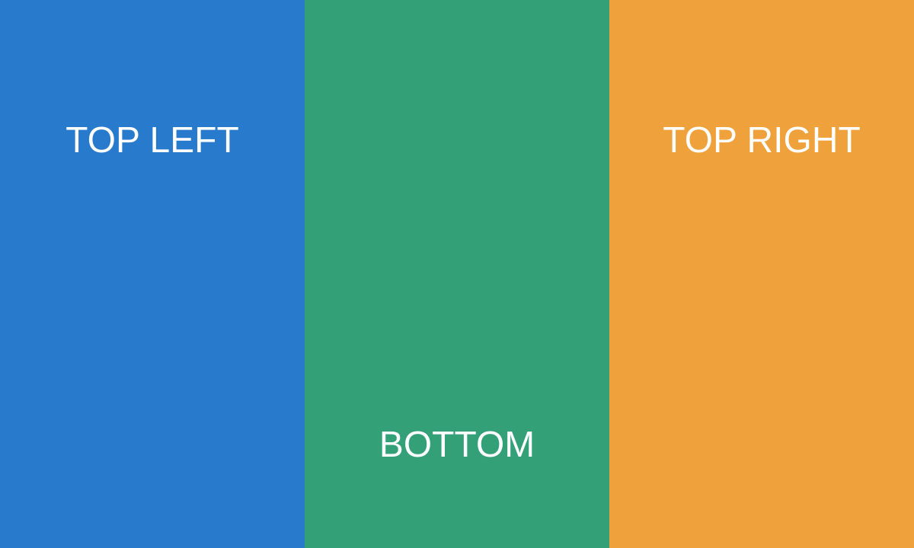

# Images

Local SVG logo:

Adjacent badges keep their proportions:

 

## Wide image

## Remote image

This image contacts img.shields.io unless `--remote-images off` is set.

## Fallback

## Navigation

Search for this sentence, open the outline with `o`, switch focus with Tab,
resize the window, and return to the wide image. Graphics must stay within
the document pane and disappear when help covers the document.
