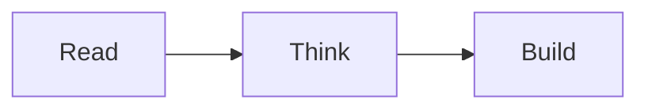

# A little room to read

Markdown, at home in your terminal.

## Ship with clarity

Read the plan before changing the code. Keep the decisions close to the work.

- Open a document without leaving your terminal.
- Search for the detail you need.
- Jump between headings with the outline.

```rust
fn main() {
    println!("Make room for reading.");
}
```

| Key | Action |
| --- | --- |
| / | Search text |
| o | Heading outline |
| q | Close the reader |

## Follow the idea



## Keep the context

Small tools. Clear documents. More time to think.
